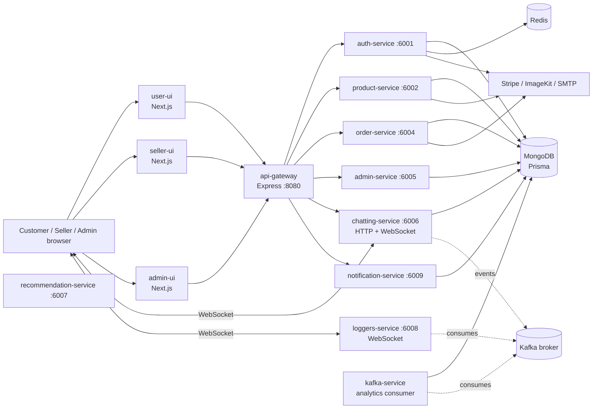

# Multi-Vendor E-commerce

A multi-vendor storefront with separate customer, seller, and administrator interfaces, backed by an Nx-managed collection of Node.js services.

[](https://opensource.org/licenses/MIT)
[](https://nx.dev/)
[](https://nextjs.org/)

There is no CI workflow in this repository, so a build-status badge is not available.

## Table of contents

- [Overview](#overview)
- [Key features](#key-features)
- [Tech stack](#tech-stack)
- [Architecture](#architecture)
- [Project structure](#project-structure)
- [Prerequisites](#prerequisites)
- [Installation and setup](#installation-and-setup)
- [Environment variables](#environment-variables)
- [Running the project](#running-the-project)
- [Usage and API](#usage-and-api)
- [Database](#database)
- [Testing and quality checks](#testing-and-quality-checks)
- [Deployment](#deployment)
- [Scripts reference](#scripts-reference)
- [Troubleshooting and FAQ](#troubleshooting-and-faq)
- [Contributing](#contributing)
- [Roadmap and known issues](#roadmap-and-known-issues)
- [License and contact](#license-and-contact)

## Overview

This repository contains a multi-vendor commerce application organized as an [Nx](https://nx.dev/) monorepo. Customers can browse products and shops, manage a cart and account, and proceed through payment and order flows. Sellers have a separate workspace for products, orders, discounts, payments, notifications, and conversations. An administrator interface provides dashboards and management screens.

The application is intended for local development and extension as a multi-tenant marketplace. Its backend is divided into Express services for authentication, products, orders, administration, notifications, chat, and gateway routing. Additional apps consume Kafka events for analytics and logs.

## Key features

- Separate Next.js applications for customers, sellers, and administrators.
- User and seller registration with email OTP verification, sign-in, password recovery, and account/profile operations.
- Product and shop browsing, filtering, product detail pages, image upload, product management, and discount-code routes.
- Cart, checkout, Stripe payment-session/payment-intent endpoints, order history, and seller order-fulfillment operations.
- User addresses, shop following and reviews, notifications, and user/seller messaging with WebSocket support.
- Admin routes and dashboard screens for users, sellers, products, orders, payments, site customization, notifications, and event/log views.
- Kafka consumers for user/shop analytics and log events.
- Shared Prisma, Redis, ImageKit, Kafka, authorization, error-handling, and UI component code.

These are capabilities represented by the checked-in routes and screens; the known limitations below describe areas that are incomplete or not verified end to end.

## Tech stack

| Layer | Technologies |
|---|---|
| Customer, seller, and admin UIs | TypeScript, React 19, Next.js 16, Tailwind CSS, TanStack Query, Zustand, React Hook Form |
| Backend APIs and gateway | Node.js, TypeScript, Express 4, `express-http-proxy` |
| Data access | Prisma 6.19 and MongoDB |
| Cache / ephemeral state | Redis through ioredis |
| Events and realtime | KafkaJS, WebSocket (`ws`) |
| Payments, uploads, email | Stripe, ImageKit, Nodemailer/SMTP |
| Workspace and tooling | Nx 22.6, npm workspaces, TypeScript 5.9, Jest 30, ESLint 9 |

## Architecture

The browser-facing applications use the API gateway for HTTP requests and connect to the chat and logger WebSocket servers for realtime features. The gateway forwards API requests to local service ports. Backend services use the shared Prisma client to access MongoDB; services that use Redis or Kafka connect to those external systems.



The gateway also contains a proxy entry for `/seller` on port `6003`; there is no separate seller-service project in this workspace. Seller registration and login routes are part of the authentication service.

## Project structure

```text
.
├── apps/
│   ├── admin-service/            Express admin API
│   ├── admin-ui/                 Admin Next.js application
│   ├── api-gateway/              HTTP proxy and gateway health route
│   ├── auth-service/             Authentication, seller onboarding, Swagger files
│   ├── auth-service-e2e/         Authentication end-to-end tests
│   ├── chatting-service/         Chat API, WebSocket server, Kafka consumer
│   ├── kafka-service/            User/shop analytics consumer
│   ├── loggers-service/          Kafka log consumer and WebSocket server
│   ├── notification-service/     User, seller, and admin notification API
│   ├── notification-service-e2e/ Notification end-to-end tests
│   ├── order-service/            Checkout, payment, orders, fulfillment
│   ├── product-service/          Catalog, shops, product images, discounts
│   ├── recommendation-service/   Minimal recommendation-service endpoint
│   ├── seller-ui/                Seller Next.js application
│   └── user-ui/                  Customer Next.js application
├── generated/prisma/             Generated Prisma client (not committed)
├── packages/
│   ├── components/               Shared UI components
│   ├── error-handler/            Shared Express error types and middleware
│   ├── lib/                      Prisma, Redis, and ImageKit clients
│   ├── middleware/               Authentication and role authorization
│   └── utils/                    Kafka and log helpers
├── prisma/
│   └── schema.prisma             MongoDB models and relations
├── .github/                      Agent and skill customizations; no CI workflow
├── .vscode/                      Workspace editor settings and launch config
├── nx.json                       Nx plugins, inputs, and target defaults
├── package.json                  Root scripts and dependencies
├── package-lock.json             npm lockfile
├── prisma.config.ts              Prisma schema, datasource, and migrations path
├── tsconfig.base.json            Shared TypeScript compiler settings and aliases
└── README.md
```

The repository also has a root `.gitignore` that excludes local `.env` files, generated Prisma code, build output, and temporary files.

## Prerequisites

- Node.js 20.9 or later. This includes the minimum required by the Next.js 16 applications. The workspace was inspected with Node.js 22.18.0.
- npm with support for `package-lock.json` version 3. The inspected environment used npm 11.10.0.
- A MongoDB instance reachable through `DATABASE_URL`.
- Redis for flows that use the Redis-backed shared client. The code defaults to `redis://localhost:6379` if `REDIS_DATABASE_URI` is not set.
- Kafka credentials for the Kafka consumers. The broker address is configured in the shared Kafka helper rather than through an environment variable.
- SMTP credentials to send registration and account-recovery email.
- Stripe keys for payment and seller Stripe Connect flows.
- An ImageKit private key to use image-upload functionality.
- Docker is optional and is only configured for the authentication service.

No root Docker Compose file, local Kafka configuration, or MongoDB setup script is included.

## Installation and setup

1. Clone the repository and enter the workspace:

   ```bash
   git clone https://github.com/rupampw007-droid/Multi-Vendor-Ecommerce.git
   cd Multi-Vendor-Ecommerce
   ```

2. Install the locked npm dependencies:

   ```bash
   npm ci
   ```

3. Configure the environment variables listed below. Keep server secrets in a local, ignored root `.env` file or provide them to the Nx process environment. Set `NEXT_PUBLIC_*` values in the relevant Next.js app environment file (for example, `apps/user-ui/.env.local`). There is no committed `.env.example`.

4. Generate the Prisma client after setting `DATABASE_URL`:

   ```bash
   npm exec prisma -- generate
   ```

5. For a development database, apply the schema to MongoDB:

   ```bash
   npm exec prisma -- db push
   ```

   `db push` synchronizes the Prisma schema directly; it is not a migration history. Review the schema and target database before running it against any data you need to preserve.

6. Start the backend services and a frontend as described in [Running the project](#running-the-project).

## Environment variables

The table lists variables referenced by the application, Prisma configuration, and the auth-service Dockerfile. Examples are local addresses or placeholders, not real credentials.

| Variable | Purpose | Required? | Example |
|---|---|---:|---|
| `DATABASE_URL` | MongoDB connection string used by Prisma. | Yes | `mongodb://127.0.0.1:27017/multivendor_ecommerce` |
| `ACCESS_TOKEN_SECRET` | Signs access tokens used by authentication middleware. | Yes | `replace-with-a-random-local-secret` |
| `REFRESH_TOKEN_SECRET` | Signs refresh tokens. | Yes | `replace-with-a-different-random-local-secret` |
| `REDIS_DATABASE_URI` | Redis connection override; the shared client defaults to local Redis. | Optional | `redis://127.0.0.1:6379` |
| `SMTP_HOST` | SMTP server hostname for email delivery. | Yes for email flows | `smtp.example.test` |
| `SMTP_PORT` | SMTP server port; code defaults to `587`. | Optional if the default is appropriate | `587` |
| `SMTP_SERVICE` | Optional Nodemailer service setting. | Optional | Leave unset when configuring host and port directly |
| `SMTP_USER` | SMTP account user and sender address. | Yes for email flows | `developer@example.test` |
| `SMTP_PASSWORD` | SMTP account password. | Yes for email flows | `replace-me` |
| `STRIPE_SECRET_KEY` | Server-side Stripe client for payments and Connect operations. | Yes for Stripe flows | `sk_test_replace_me` |
| `STRIPE_WEBHOOK_SECRET` | Verifies Stripe webhook signatures. | Yes for webhook processing | `whsec_replace_me` |
| `IMAGEKIT_PRIVATE_KEY` | Authenticates ImageKit operations. | Yes for ImageKit uploads | `private_replace_me` |
| `KAFKA_API_KEY` | Kafka SASL username. | Yes for Kafka consumers | `replace-me` |
| `KAFKA_API_SECRET` | Kafka SASL password. | Yes for Kafka consumers | `replace-me` |
| `NEXT_PUBLIC_SERVER_URI` | Base HTTP URL used by the UIs to call the backend; point it at the gateway for the full local stack. | Yes for UI/API use | `http://localhost:8080` |
| `NEXT_PUBLIC_CHATTING_WEBSOCKET_URI` | WebSocket URL used by user and seller chat interfaces. | Yes for chat UI | `ws://localhost:6006` |
| `NEXT_PUBLIC_SOCKET_URI` | WebSocket URL used by the admin logger screen. | Optional until using that screen | `ws://localhost:6008` |
| `NEXT_PUBLIC_STRIPE_PUBLIC_KEY` | Stripe publishable key used by checkout UI. | Yes for checkout | `pk_test_replace_me` |
| `NEXT_PUBLIC_USER_UI_LINK` | Customer UI link used by the seller product interface. | Optional | `http://localhost:3000` |
| `SELLER_UI_URL` | Seller return URL used by Stripe Connect onboarding; required by the code for this flow in production. | Required for production onboarding | `http://localhost:3001` |
| `PORT` | Overrides a service's default listen port. The gateway defaults to `8080`; HTTP services use ports `6001`, `6002`, and `6004`-`6009` by default. | Optional | `6001` |
| `HOST` | Set to `0.0.0.0` by the authentication-service Dockerfile. | Container default | `0.0.0.0` |
| `NODE_ENV` | Runtime/build mode checked in the workspace configuration. | Optional | `development` |

The Kafka helper currently sets the broker address in code; there is no `KAFKA_BROKERS` variable. Do not commit credentials or publish `NEXT_PUBLIC_*` values that should remain private; Next.js exposes public-prefixed values to browser bundles.

## Running the project

### Backend services

From the repository root:

```bash
npm run dev
```

This invokes Nx `run-many --target=serve --all`; it starts projects with a `serve` target, not the Next.js `dev` targets. The API gateway listens on port `8080` by default. Service defaults include auth `6001`, product `6002`, order `6004`, admin `6005`, chat `6006`, recommendation `6007`, logger `6008`, and notifications `6009`. Kafka analytics is a worker and does not expose an HTTP listen port.

The gateway expects its upstream services on fixed localhost ports. The service processes also require the relevant database, cache, Kafka, SMTP, Stripe, and ImageKit configuration for the features that use them.

### Frontend applications

Run the selected UI in a separate terminal:

```bash
npm run user-ui
```

Other available UI scripts are:

```bash
npm run seller-ui
npm run admin-ui
```

Each Nx Next.js `dev` target uses the Next.js development server. The three apps use the same default Next.js port unless configured otherwise, so run one at a time or assign separate ports and ensure the gateway CORS settings allow the chosen origins.

### Production mode

Nx exposes `build` targets for the services and UIs. For example:

```bash
npm exec nx -- run-many --target=build --all
npm exec nx -- run @multivendor-ecommerce/user-ui:build
npm exec nx -- run @multivendor-ecommerce/user-ui:start
npm exec nx -- run @multivendor-ecommerce/auth-service:build --configuration=production
```

The repository does not define a root production launcher or a production deployment topology for all services. See [Deployment](#deployment) for the limited Docker support.

## Usage and API

### Example requests

The gateway health route is available at `GET http://localhost:8080/gateway-health` and returns:

```json
{ "message": "Welcome to api-gateway!" }
```

User registration starts by requesting an OTP. The example uses the gateway's root proxy to the authentication service:

```bash
curl -X POST http://localhost:8080/api/user-registration \
  -H "Content-Type: application/json" \
  -d '{"name":"Ada Example","email":"ada@example.test"}'
```

The service responds with a message that an OTP was sent. SMTP must be configured; then submit the OTP with `name`, `email`, and `password` to `POST /api/verify-user`. A successful verification returns a success flag and message.

### HTTP service routes

The paths below are relative to the service's `/api` router unless stated otherwise. Through the API gateway, the authentication routes are at `/api/...`; product, order, admin, chat, and notification routes are proxied under `/product`, `/order`, `/admin`, `/chatting`, and `/notification`, respectively. Authentication/role requirements are enforced by middleware in the service routes.

#### Authentication service (`6001`)

Defined in [`auth.route.ts`](./apps/auth-service/src/routes/auth.route.ts).

| Methods | Routes |
|---|---|
| `POST` | `/user-registration`, `/verify-user`, `/login-user`, `/login-admin`, `/refresh-token`, `/logout-user` |
| `GET` | `/logged-in-user`, `/logged-in-seller` |
| `PATCH` | `/user-profile`, `/follow-shop/:shopId`, `/change-password-user` |
| `GET`, `POST` | `/user-addresses` |
| `PUT`, `DELETE` | `/user-addresses/:id` |
| `PATCH` | `/user-addresses/:id/default` |
| `POST` | `/forgot-password-user`, `/reset-password-user`, `/verify-forgot-password-user` |
| `POST` | `/seller-registration`, `/verify-seller`, `/create-shop`, `/create-stripe-link` |
| `POST` | `/login-seller` |
| `GET` | `/stripe-connect-status` |

#### Product service (`6002`)

Defined in [`product.route.ts`](./apps/product-service/src/routes/product.route.ts).

| Methods | Routes |
|---|---|
| `GET` | `/get-categories`, `/get-all-products`, `/get-all-events`, `/get-product/:slug`, `/get-filtered-products`, `/get-filtered-events`, `/get-filtered-shops`, `/get-shop/:id`, `/get-top-shops` |
| `POST` | `/create-discount-code`, `/upload-product-image`, `/create-product` |
| `GET` | `/get-discount-codes`, `/get-shop-products` |
| `DELETE` | `/delete-discount-code/:id`, `/delete-product-image`, `/delete-product/:id` |
| `PUT` | `/recover-deleted-product/:id` |

#### Order service (`6004`)

Defined in [`order.route.ts`](./apps/order-service/src/routes/order.route.ts). The Stripe webhook handler is separately registered by the service entry point.

| Methods | Routes |
|---|---|
| `POST` | `/create-payment-session`, `/create-payment-intent` |
| `GET` | `/verify-payment-session`, `/get-seller-orders`, `/get-seller-orders/:id`, `/get-order-details/:id`, `/get-user-orders`, `/get-admin-orders` |
| `PATCH` | `/get-seller-orders/:id/fulfillment` |
| `PUT` | `/verify-coupon` |
| `POST` | `/create-order` (raw-body Stripe webhook handler in the service) |

#### Admin service (`6005`)

Defined in [`admin.routes.ts`](./apps/admin-service/src/routes/admin.routes.ts). All listed routes require an authenticated administrator.

| Methods | Routes |
|---|---|
| `GET` | `/admin-session`, `/dashboard-stats`, `/get-all-products`, `/get-all-events`, `/get-all-admins`, `/get-all-users`, `/get-all-sellers`, `/get-all` |
| `PUT` | `/add-new-admin`, `/customizations` |

#### Chat and notifications

Chat routes are defined in [`chat.routes.ts`](./apps/chatting-service/src/routes/chat.routes.ts). Notifications are mounted separately for user, seller, and admin roles in [`notifications.routes.ts`](./apps/notification-service/src/routes/notifications.routes.ts).

| Service | Methods and routes |
|---|---|
| Chat (`6006`) | `POST /create-user-conversationGroup`, `GET /get-user-conversation`, `GET /get-seller-conversations`, `GET /get-messages/:conversationId`, `GET /get-seller-messages/:conversationId`, `POST /messages`, `POST /seller-messages`, `POST /attachments`, `POST /seller-attachments` |
| Notifications (`6009`) | For `/api/user/notifications`, `/api/seller/notifications`, and `/api/admin/notifications`: `GET /`, `GET /unread-count`, `PATCH /read-all`, `PATCH /:id/read`, `DELETE /:id`. Admin notifications also support `POST /broadcast`. |

The authentication and product services also expose Swagger UI at `/api-docs` and the generated document at `/docs-json` when those services are running directly (ports `6001` and `6002`).

### WebSocket and worker processes

- The chat service creates a WebSocket server on its HTTP server and starts a Kafka message consumer.
- The logger service provides a WebSocket server and consumes Kafka log events.
- The Kafka service consumes the `user-events` topic and updates user/shop analytics.
- The recommendation service currently exposes only a basic `/api` response; it is not yet a recommendation API.

## Database

The Prisma datasource is MongoDB. [`schema.prisma`](./prisma/schema.prisma) defines these main model groups:

| Models | Purpose |
|---|---|
| `users`, `sellers`, `shops`, `images` | Accounts, seller shops, and media references |
| `products`, `events`, `discount_codes`, `site_config` | Catalog, promotions, and storefront configuration |
| `orders`, `orderFulfillments`, `userAddress`, `shopReviews` | Checkout, fulfillment, saved addresses, and reviews |
| `notifications` | Role-scoped notifications and order references |
| `UserAnalytics`, `ProductAnalytics`, `ShopAnalytics` | User actions and shop/product activity |
| `conversationGroup`, `participant`, `message` | Conversations, membership, and messages |

Prisma configuration points to `prisma/schema.prisma` and declares `prisma/migrations` as the migrations directory, but no migration files or seed script are checked in. The API gateway attempts to create initial `site_config` categories when it starts and no configuration record exists.

For development, generate the client with `npm exec prisma -- generate` and apply schema changes with `npm exec prisma -- db push`. No database reset or seeding command is provided.

## Testing and quality checks

Run configured unit-test targets:

```bash
npm exec nx -- run-many --target=test --all
```

The currently configured auth-service and API-gateway Jest targets both use `passWithNoTests`; the command succeeds even when it finds no tests. There are separate end-to-end targets:

```bash
npm exec nx -- run @multivendor-ecommerce/auth-service-e2e:e2e
npm exec nx -- run notification-service-e2e:e2e
```

End-to-end targets start their corresponding services and therefore need the relevant runtime configuration and dependencies.

Run workspace lint and type checks with:

```bash
npm exec nx -- run-many --target=lint --all
npm exec nx -- run-many --target=typecheck --all
```

## Deployment

- The only checked-in Dockerfile is [`apps/auth-service/Dockerfile`](./apps/auth-service/Dockerfile). Nx provides an authentication-service Docker build target; the Dockerfile comment documents `npx nx docker:build @multivendor-ecommerce/auth-service`.
- No root Dockerfile, Docker Compose file, Kubernetes manifests, infrastructure-as-code, CI workflow, or general deployment guide is present.
- Other projects expose Nx build targets, but containerization and production orchestration for the full application are not configured in this repository.
- Set production secrets through the deployment environment. Do not add them to source control or expose server-only credentials through `NEXT_PUBLIC_*`.

## Scripts reference

Root npm scripts from [`package.json`](./package.json):

| Command | Purpose |
|---|---|
| `npm run dev` | Run all Nx projects with a `serve` target. |
| `npm run user-ui` | Run the user UI's Nx `dev` target. |
| `npm run seller-ui` | Run the seller UI's Nx `dev` target. |
| `npm run admin-ui` | Run the admin UI's Nx `dev` target. |
| `npm run auth-docs` | Invoke the authentication service Swagger generator script. |
| `npm run product-docs` | Invoke the product service Swagger generator script. |

Common Nx targets include `build`, `serve`, `dev`, `start`, `lint`, `typecheck`, `test`, and the two e2e targets. Not every target is available on every project; inspect the resolved target list with:

```bash
npm exec nx -- show project @multivendor-ecommerce/auth-service
```

## Troubleshooting and FAQ

### MongoDB connection or Prisma client errors

Check that `DATABASE_URL` points to a running MongoDB instance, then run `npm exec prisma -- generate`. Use `npm exec prisma -- db push` only when you intend to synchronize that database with the current schema.

### Registration or password recovery does not send email

Set `SMTP_HOST`, `SMTP_USER`, and `SMTP_PASSWORD`. The code defaults `SMTP_PORT` to `587`; `SMTP_SERVICE` is optional when configuring the host and port directly. These flows depend on an SMTP server.

### Kafka consumers cannot connect

Set `KAFKA_API_KEY` and `KAFKA_API_SECRET`. The current Kafka broker address is hard-coded in `packages/utils/kafka/index.ts`; there is no local broker configuration in the repository.

### Checkout, webhooks, or Connect onboarding fail

Set the Stripe server and publishable keys, and set `STRIPE_WEBHOOK_SECRET` for webhook verification. For production Stripe Connect onboarding, set `SELLER_UI_URL`.

### UI requests fail or realtime features do not connect

Set `NEXT_PUBLIC_SERVER_URI` to the running gateway, usually `http://localhost:8080`. Set the chat and logger WebSocket URLs to their running services. Check the gateway's fixed upstream ports and the CORS origins in the gateway and services if you use non-default frontend ports.

### Port already in use

Set `PORT` for the individual service or select another port for the Next.js dev server. The gateway's upstream mappings are hard-coded, so changing a service port also requires updating the gateway configuration.

### Workspace build reports errors

The last verified `npm exec nx -- run-many --target=build --all` run failed in this checkout: the auth-service build reports an unused `timeStamp` import in `packages/utils/logs/send-logs.ts`, and the user UI build could not fetch the Poppins font from Google Fonts in that environment. The other build targets completed. These are existing code/environment issues; they are not addressed by this documentation change.

## Contributing

No project-specific contribution guide, branch policy, or commit convention is checked in. A reasonable contribution workflow is:

1. Create a focused branch from the current default branch.
2. Keep changes scoped to one feature or fix and use descriptive commit messages.
3. Run the relevant Nx lint, type-check, build, and test targets.
4. Open a pull request describing the change, validation performed, and any required environment or database changes.

## Roadmap and known issues

No explicit roadmap or `TODO`/`FIXME` markers were found in the application source. The following implementation gaps were visible during repository review:

- The recommendation service is currently a minimal placeholder endpoint.
- The gateway forwards `/seller` to port `6003`, but no separate service listens on that port in this workspace; seller auth routes are in `auth-service`.
- The gateway rewrites its Stripe webhook request to `/api/stripe-webhook`, while the order service registers the raw-body webhook handler at `/api/create-order`. Align these paths before relying on webhook delivery through the gateway.
- The configured unit-test targets currently find no Jest tests. The repository has auth and notification e2e projects.
- The build failures noted under [Troubleshooting](#workspace-build-reports-errors) should be resolved and rechecked.

## License and contact

The root `package.json` declares the project license as MIT, but no `LICENSE` file is checked in. Confirm the intended license and add its full text before distributing the project.

<!-- TODO: confirm the project license and add a LICENSE file. -->
<!-- TODO: add maintainer or support contact information. -->
